# 10. What's new in 0.4

This chapter lists every user-facing change in gpuwm-hex 0.4: what it does, the
command that reaches it, what it was proven on, what it does not yet do, and a
picture where one exists. The pictures are reduced copies of the Rust
renderer's own maps (weather fields) or plots of measured numbers (marked as
charts). Full-size originals and their source hashes are kept with the release
evidence.

0.4 needs the gpuwm 2.9 engine (`gpuwm>=2.9.0,<2.10`; pip installs it): it
calls the engine's generic MPAS column physics entry and its new renderer
pieces, which earlier engines do not have.

**In one paragraph.** 0.3.3 was the MPAS-Atmosphere dynamical core on the GPU,
running ArWen's physics. 0.4 is the whole of MPAS-A v8.4.2 on the GPU: the
dycore now gives the same bits as native MPAS, both MPAS physics suites are
ported scheme by scheme, and one 24-hour forecast with every physics scheme on
the GPU matches native MPAS in every field hex writes. Initialization, static
fields, IAU, limited-area boundaries, streams, restart and diagnostics are
ported too, each checked against native before it landed. Matching exactly
found real defects in native MPAS; correct mode, the default, fixes five of
them. ArWen's physics stays the default, and the release adds a one-command
global forecast, an experimental storm-following region and RRFS-MPAS running
end to end.

## The dycore is byte-identical to native MPAS

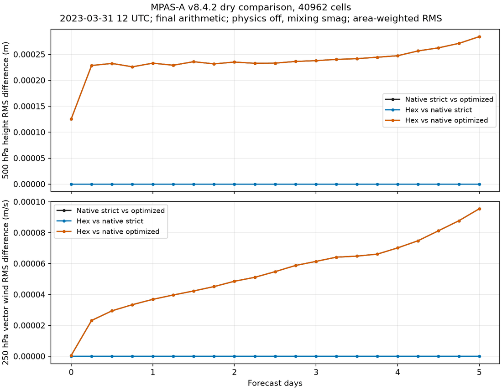

*Chart.* The same dry five-day forecast from hex and from native MPAS-A v8.4.2.
Blue, hex against native built strictly: zero on every one of the 21 checks.
Orange, hex against native built fast: it lies exactly on black, which is
native-strict against native-fast.

Every 32-bit number of every compared field matches native MPAS-A v8.4.2 built
with the pinned strict GNU recipe, with no tolerance: dry on two meshes and two
five-day dates, and with water vapour and with five condensates transported for
five days. Getting there took nineteen changes to the order and precision of
operations, none to the equations, time scheme or damping.

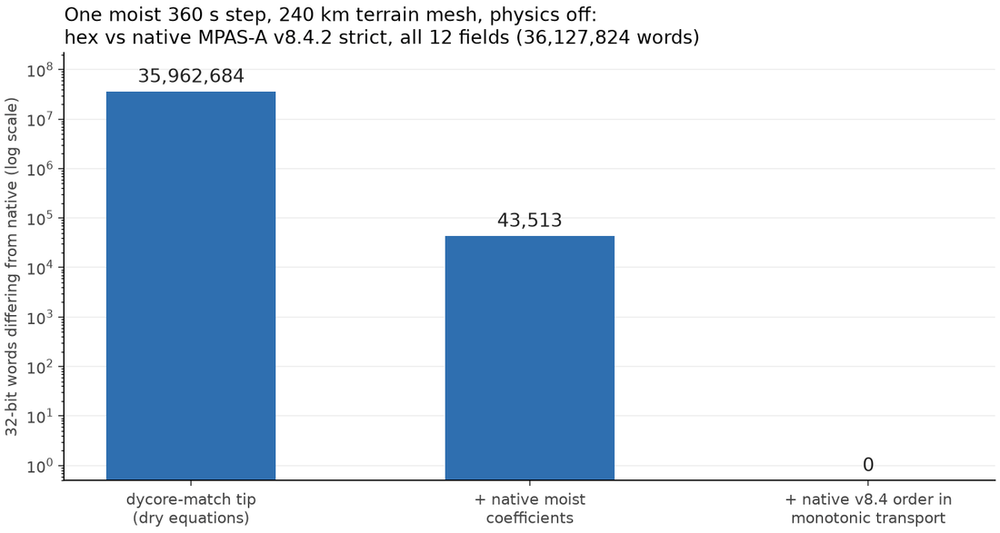

*Chart.* One moist step: almost 36 million differing numbers before the moist
work, 43,513 after native's moist coefficients, zero after native's order in
the moisture transport.

- **Reach it:** `gpuwm-hex verify-dycore --work-root ./native-reference`
  rebuilds the pinned native reference on a Linux host and requires 0 differing
  words against the strict build. It runs from an unpacked source
  distribution or a clone (`python -m pip install -e '.[gpu]'` inside it),
  because the native build recipe ships there, not in the wheel; from a wheel
  install the door says so by name.
- **Scope:** the dycore with physics off; one host (the C maths library must
  be the same for hex and native; the receipt names the host's glibc);
  same-host ranks share one card. Local time stepping, distinct cards and
  other meshes are not claimed. Details: [MPAS compatibility](../mpas-compatibility.md).

## MPAS physics on the GPU, matching native

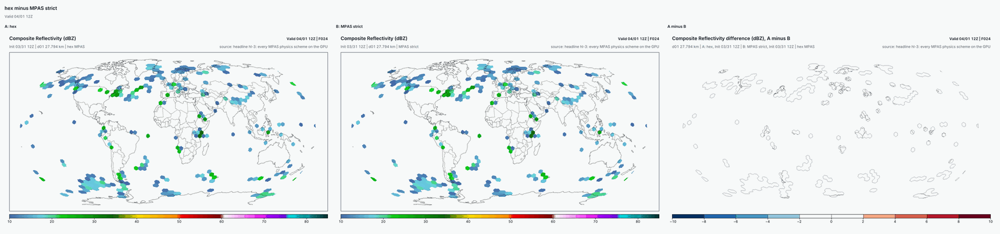

*Map.* Composite radar 24 hours into the headline forecast: hex with every
physics scheme on the GPU (left), native MPAS-A v8.4.2 (middle), hex minus
native (right). The same echoes in the same places at the same strength. The
difference panel is white; its colour bands are 2 dBZ wide, so the zero comes
from the recorded largest difference, 0, not from the colour alone.

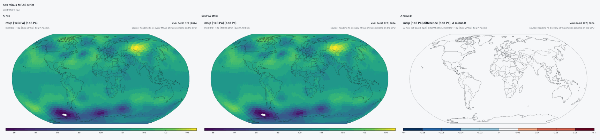

*Map.* Sea-level pressure at 24 hours, the same three panels, on difference
bands 0.2 hPa wide. The Siberian high and the Southern Ocean lows are the same;
the difference panel is white everywhere.

The MPAS-A v8.4.2 physics suites (`mesoscale_reference` and
`convection_permitting`) run through MPAS's own physics driver, ported. Each
physics slot runs hex's CUDA port (`hex-cuda`) by default; a slot this install
cannot run on the GPU runs native MPAS Fortran (`native-cpu`) and the run says
so at start-up and in its receipt. `--physics-default-backend native-cpu` runs
every slot on native MPAS Fortran, the referee.

- **The headline:** a 24-hour `convection_permitting` forecast with all ten of
  its physics schemes on the GPU (Thompson, Grell-Freitas, MYNN boundary layer
  and surface layer, Noah, sea ice, YSU orographic drag, cloud fraction, RRTMG
  longwave and shortwave) matches native MPAS-A v8.4.2 bit for bit in every
  field hex writes: 545,733,285 values, 0 different. Native also writes about
  105 million values hex does not write yet; they are counted, not hidden.
- **Every other scheme:** Kessler, WSM6, Kain-Fritsch, Tiedtke, New Tiedtke,
  the revised MM5 surface layer, YSU, NOAA GSL's UGWP orographic drag and
  non-stationary gravity waves (US Government code by the project's ruling;
  NOTICE section 8), Noah-MP (with its urban switch; private
  builds only, see below), the ocean
  mixed layer and CAM radiation are each bitwise against native on real inputs
  captured from a native run, and a forecast with each on was compared with
  native map by map.
- **Reach it:** `gpuwm-hex physics-resources build`, then `gpuwm-hex forecast
  --physics-backend mpasphys --physics-namelist namelist.atmosphere --streams
  streams.atmosphere ...` with a backend selector per slot. The build compiles
  the native framework library on your host (GNU Fortran and the
  netCDF-Fortran development files required), with Noah-MP v5.0 replaced by
  an Apache-2.0 interface stub unless `--licence-opt-in ucar-noahmp` is given
  ([MPAS physics resources](../physics-resources.md)), fetches the pinned
  MPAS-Model v8.4.2 tree and the MPAS-Data tables by SHA-256, and writes the
  GPU schemes' resource packet; the Registry pool reader ships in the wheel.
  A forecast on the MPAS route builds anything still missing on first use, and a flag that
  names a piece always wins. The README's *Running an MPAS physics suite* has
  the whole command and [MPAS physics resources](../physics-resources.md) the
  details; `verification/gates/decks/mpas-headline-convection-permitting.json`
  is the headline's own deck.
- **Proven:** `x1.2562` (480 km), 2023-03-31 12Z, one process, exact mode, for
  the headline; it is a landing gate, so every later change kept it exact.
  Both suites with every scheme on the native backend are bitwise in every
  written field too.
- **Aerosol-aware Thompson** (`mp_thompson_aerosols`) runs on the GPU from a
  plain install: `gpuwm-hex physics-resources build` generates its aerosol
  tables, and a 3-hour `x1.2562` forecast with it on the GPU matched native
  MPAS bit for bit at every hour (exact mode, one process; 5,579,490 values
  in 79 fields at 3 hours, 0 different).
- **Not yet:** a whole-forecast match for each scheme one by one, other
  meshes and process counts for the all-GPU forecast, and the CUDA
  port of Noah-MP v5.0, which is withheld because UCAR's terms do not allow a
  distribution that may be sold.
  `gpuwm-hex physics-resources build` builds the hex-cuda Kain-Fritsch packet,
  so Kain-Fritsch runs on the GPU from a plain install with any microphysics
  that carries ice; with Kessler (no ice) it is refused by name, because
  native MPAS reads an argument there that it never sets.

## Correct mode: MPAS with its defects fixed

Matching native MPAS exactly showed where native MPAS itself is wrong. Every
door now runs **correct mode** by default. On an MPAS suite it fixes five of
those defects:

1. MYNN removes cloud water, ice and snow on every call (RP1).
2. The TKE-advection flag resets TKE to a field that was never advected;
   correct mode refuses the setting, as a corrected native build does (RP4).
3. The PBL interval stretches the step while the schemes still run every
   step, which integrates twice over (RP6).
4. Precipitable water divides by (1+qv) a second time, so it reads about 0.6%
   low (WB3).
5. WSM6 books the below-ground part of a falling cell flat, while its remap
   moves it on a slope (WB5).

- **Reach it:** nothing to set. `--physics-mode exact` reproduces native MPAS
  bit for bit; `--physics-correct-skip ID` leaves one fix out for an A/B arm.
- **Outside the MPAS suites:** on the default ArWen physics route correct
  mode applies the corrections the installed engine carries (WB4, New
  Tiedtke's dry-mass coupling; WB5, WSM6's surface integral); with
  `--iau-route native` it applies the IAU fixes IN1-IN3; the boundary door
  passes the mode on.
- **Proven:** each fix has a test that fails on native behaviour and passes
  with it, and each matches its own native referee, a native build carrying
  that one fix, word for word.
- **Loud, never silent:** a fix a scheme does not carry yet is not a refusal.
  The run keeps native behaviour for it and prints
  `CORRECT MODE: named gaps ...` at start-up, with the finding, scheme, reason
  and owner, and the same goes into the run receipt.
- **Not yet:** a combined forecast checked against one native build carrying
  every fix. Guide: [MPAS physics seam](mpas-physics-seam.md#correct-mode-and-exact-mode).

## Initialization, statics and the rest of MPAS

- **Real-data initialization** (MPAS case 7): 2,880 captured native calls
  replayed, 0 different words; a cold start from it matches all 134 native
  fields.
- **Static fields** with `rw_mpas_static`: every word as native writes it,
  except 1,662 values where native itself reads undefined memory (declared
  residue). With `--native-gwd-static`, the full 79-field static file: 4 cases,
  11,675,352 words, 0 different.
- **The SST and sea-ice update** (`gpuwm-hex surface-update`): a forecast with
  SST updates on matches native in every written field (581,775,705 values).
- **IAU** (`--iau-analysis`), **limited-area boundaries**, **streams and
  restart**, the **GOCART aerosol climatology** and the **isobaric, convective,
  cloud, potential-vorticity and sounding diagnostics**: each bitwise against
  native on captured inputs.
- **A forecast from an analysis** (`gpuwm-hex forecast --analysis BUNDLE`):
  direct insertion, an IAU window from the bundle's increment, a DA-cycling
  restart, or a remap onto another mesh. `--iau-route native` runs MPAS-A
  v8.4.2's own IAU kernels on the forecast step, with the IAU correct-mode
  fixes IN1-IN3 applied in correct mode. The bundle format is
  [docs/analysis-bundle.md](../analysis-bundle.md).
- **LES** (`config_les_model` `3d_smagorinsky` or `prognostic_1.5_order`) runs
  on the MPAS route (`--physics-backend mpasphys`): MPAS-A v8.4.2's LES
  dissipation module on the GPU, in the dycore's RK step.

## Hex global, in one command

- **Reach it:**
  `gpuwm-hex global --row global-120km --cycle 2026-10-11T12 --work-dir RUN`.
  Mesh, native static, init, forecast, products, export and scores in one
  command; rows at 120, 60, 30 and 15 km.
- **Proven:** the 120 km row, 24 hours on a 16 GB card, in 7.5 minutes for the
  whole command. On that case its 500 hPa height error against the GFS
  analysis was 10.0 m, against 14.9 and 13.5 m for gpuwm-global's T127 and
  T255 runs. One case is not a skill claim.
- **Hex global is the main global model; gpuwm-global remains available as a
  second (spectral) global model.** gpuwm-global's public LETKF stays in
  gpuwm-global. Hex global starts from an analysis you supply
  (`gpuwm-hex forecast --analysis`).
- Guide: [Hex global](../global-door.md).

## A storm-following region (experimental)

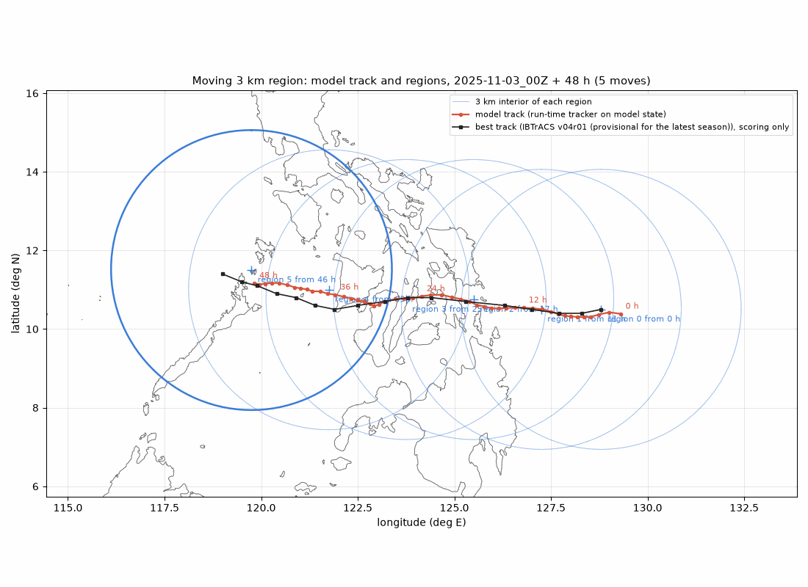

*Chart.* Typhoon Kalmaegi, 48 hours from 2025-11-03 00Z. Red: the storm track
the model's own tracker found while the forecast ran. Black: the best track,
used only for scoring. Circles: the 3 km interior of each region; the run
started in one and moved five times, keeping the storm inside.

- **What it is:** a 3 km region about 450 km in radius that moves with a storm
  inside a 48 km global mesh, on ArWen physics and the MPAS-exact dycore.
- **Proven:** three tropical cyclones, 48 hours and five moves each, on one
  card. The storm stayed inside the 3 km region at every hourly output; mass
  and tracers held to within 1e-10 at each move; a restart across a move
  continued bit for bit (one move tested).
- **The door:** `gpuwm-hex moving` (`stage`, `prepare`, `run`, `fixed` for the
  matched control, and `check`, which tests an install with no inputs).
  Guide: [Moving nests](../moving-nest.md).
- **The balance fix is the default.** Those three runs used the remap before
  it, and at 2 of the 15 moves the short-term shock went over its limit
  (1.5004 and 1.81 against 1.5). On `gpuwm-hex moving check` the fix brings
  the worst post-move jolt from 16.2 to 1.01 on a card with local time
  stepping and from 21.4 to 1.04 on the CPU (ordinary integrator); see
  [the jolt report](../moving-jolt-report.md).
- **MPAS physics moves too.** A case whose physics is an MPAS-A v8.4.2 suite
  carries the suite's own state across each move, so convection, boundary
  layer, land and radiation memory continue (see the guide).
- **Not yet:** a full-cyclone replay of those two moves with the fix (it needs
  a card with about 64 GB or more).

## RRFS-MPAS runs end to end

NOAA's MPAS configuration, built on the GSL v8.3.1 fork, is a separate core
that runs end to end in hex: the fork's dycore on the GPU, its ported physics
on the GPU by default and the rest through the fork's native library. Its
suite `hrrrv5` runs the fork's NOAA GSL physics
by default, with no opt-in: the project treats that physics, and UGWP, whose
CUDA ports ship in 0.4, as US Government code (`NOTICE` sections 8 and 9).

- **Proven:** on real inputs captured from the native fork build (global and
  regional cases, one process), the fork's dynamical core as a module replay,
  1,235,615,738 words, 0 different, and its physics driver layer, 104,976,732
  words, 0 different.
- **Exact as a whole forecast with the native-library physics:** a one-hour
  `hrrrv5` run on `x1.2562` (one process), the fork's dycore on the GPU and
  every physics slot on the native library, is bitwise to the native fork
  build in every field hex writes: 40,525,734 words, 0 different
  (`--physics-default-backend native-cpu`). By default the ported RRFS
  schemes run on the GPU, each bitwise as a module replay; a whole forecast
  with them on is not claimed bitwise.
- **From a pip install:** `gpuwm-hex physics-resources build` compiles the
  fork's native library on your machine from the RRFS fork's own source
  (RRFSx/MPAS-Model 1d6e370e and its submodule pins, fetched by SHA-256) and
  fetches the fork's Registry and physics tables, including the TEMPO v3
  tables and `ccn_activate.bin` from NOAA's published RRFS fix files (about
  1 GB); an RRFS forecast builds them on first use. Noah-MP v5.0 inside the
  fork is its licence stub unless opted in. The wheel bundles the fork
  dycore's three Rust programs.
- **Not yet:** RRFS initial conditions. Hex does not make them; bring
  `init.nc` (with the static and invariant files) from the fork's own
  `init_atmosphere`.

## Products at the end of every forecast

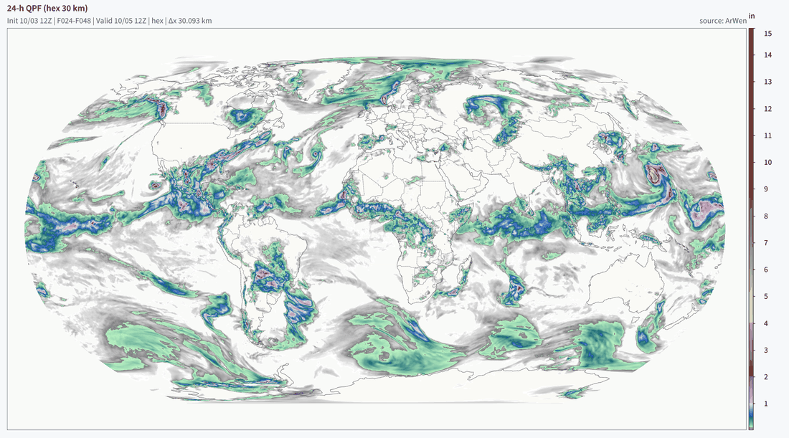

*Map.* Rain and snow during the second day of a 30 km global forecast, one of
426 maps the door drew from that run.

- **Reach it:** nothing extra. `gpuwm-hex forecast` ends by drawing the
  standard set into `<out>/products`. The drawing runs as its own CPU-only
  process (log `<out>/products.log`), so the forecast returns and frees its
  cards as soon as its receipt is written; `--no-products-detached` draws
  inside the forecast command instead, and `--no-products` stops at the
  history files and prints the products command. On any finished run:
  `gpuwm-hex products RUN_FOLDER`.
- **What you get:** maps (precipitation over 1, 6 and 24 hours and since the
  start, radar, satellite, jets, vorticity, temperature, pressure, precipitation
  type), soundings with hodographs and storm parameters, and meteograms, for
  the globe, automatic regional views and the fine part of a variable mesh.
- **Proven:** the 30 km global 0-48 h set (426 maps, 54 soundings, 6
  meteograms) in 3 min 53 s; a 48-3 km patch run's 803 maps in 3 min 15 s; the
  history files' hashes are unchanged after drawing.
- **Soundings and meteograms** need `rw_hex_points`, which the gpuwm 2.9.0
  wheel carries. An engine without it still gets the maps: the forecast's
  automatic stage draws them and prints what it skipped and how to get the
  tool; `gpuwm-hex products` run by hand refuses by name, and `--no-points`
  draws the maps alone.
- Guide: [products door](../products-door.md).

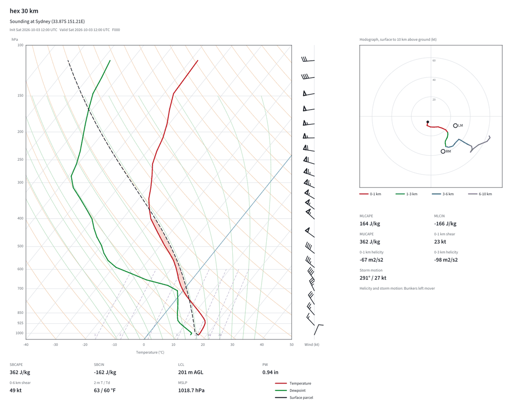

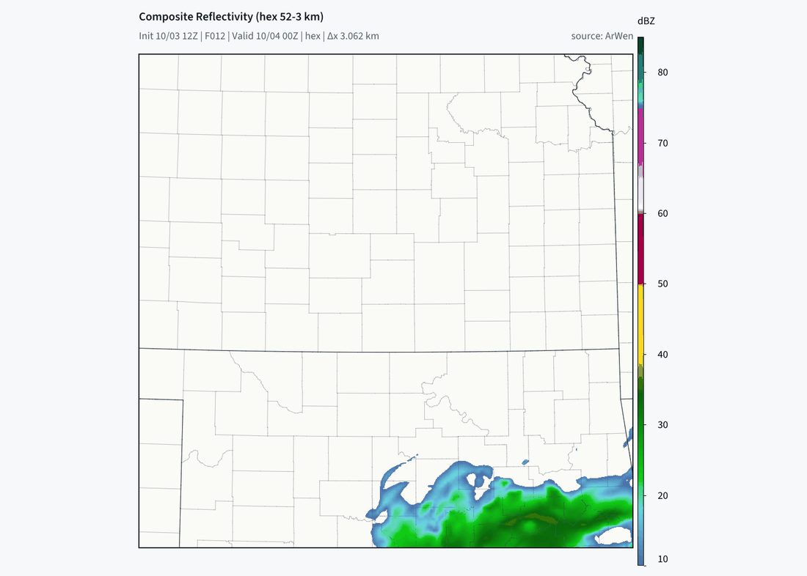

## Restart, and starting from an analysis

- **Reach it:** `gpuwm-hex forecast ... --checkpoint-hours 3` writes a
  checkpoint at that history frame; rerun the same command with
  `--restart-from OUT/checkpoint.<time>.pkl` to continue.
  `--restart-from CKPT --da-analysis ANALYSIS.nc` continues from an analysis
  instead of the checkpoint's dycore state; `--jedi-background` writes the
  background an MPAS-JEDI analysis reads.
- **Proven:** six hours straight against three hours plus restart, on a
  two-card global 30 km run and on a one-card local-time-stepping patch run:
  all 117 field hashes equal in each pair.
- **Not yet:** data assimilation on several ranks, and local time stepping
  cycling on several cards, are refused by name. Assimilation through this door
  has not been shown to improve a forecast.
- Guide: [full-step local time stepping, restart section](../fullstep-local-timestep.md).

## Initial conditions from seven sources, one table

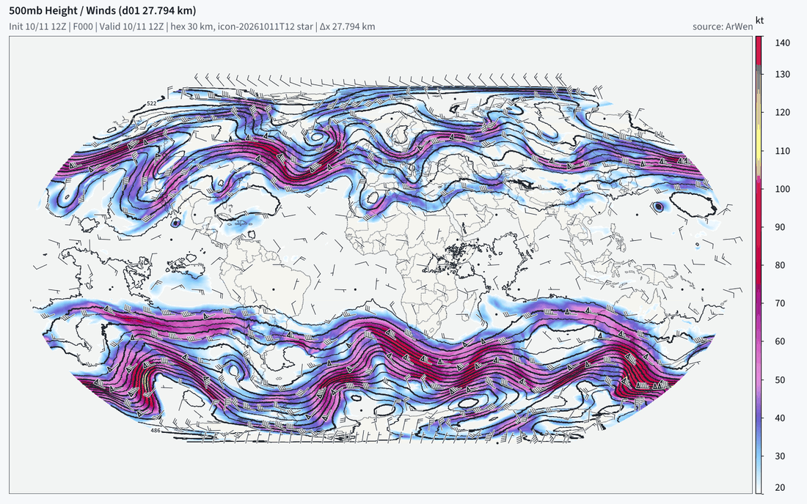

*Map.* Hour 0 of a run started from DWD ICON through the table: whole globe,
no seam at the date line or poles.

- **Reach it:** `gpuwm-hex init-source --list`, then
  `gpuwm-hex init-source --source ROW --cycle YYYY-MM-DDTHH --grid ... --static ...`.
  Rows: GFS, IFS, AIFS, IFS-ENS and GEFS members, ERA5, ICON. A new source is
  a new table row, not new code.
- **Proven:** the GFS init this path builds equals the shared GFS case init in
  all 138 variables.
- **ICON:** an ICON-built init runs a forecast: 2 hours on `x1.40962` from a
  plain install, one card, normal maps; card memory sampled every 10 s peaked
  at 9.9 GB against the door's estimate of 10.0 GB. An earlier build's ICON
  forecast stopped out of card memory at 1.75 hours; that did not recur.
- **Not yet:** the IFS, AIFS, IFS-ENS, GEFS and ERA5 rows build inits and have
  not run a forecast.
- Guide: [init sources](../init-sources.md).

## Country rows

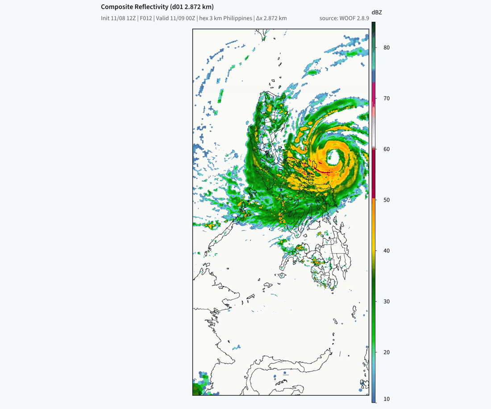

*Map.* Typhoon Fung-wong 12 hours into a 48-hour forecast on the Philippines
48-3 km mesh that the `philippines` row names.

- **Reach it:** `gpuwm-hex country --row philippines --cycle 2025-11-03T00 --work-dir ./country`
  prints the plan; `--stage prepare`, `forecast`, `products` and `score` run it.
  The forecast runs the installed engine; `--gpuwm-checkout` is optional.
  A country is a row of data (mesh, init source, vertical grid, score region,
  product set), never code.
- **Proven:** the Philippines default ran 192 steps on two cards, exit 0.
- Guide: [country door](../country-door.md).

## Observation scorecard

- **Reach it:** `gpuwm-hex score RUN/fc`, also run at the end of a country
  forecast. It scores every retained frame against surface stations,
  radiosondes and rain observations through Rust and states every missing
  observation as its own row.
- **First reading, reported as measured:** one 48-hour 30 km forecast
  (2026-01-15 12Z) was worse than GFS on 42 of 44 rows, worst near the ground
  (2 m temperature RMSE 3.49 K against 3.04 K). The scorecard is how 0.4's
  physics is judged; it does not yet say the physics is good.
- Guide: [observation scorecard](../forecast-observation-scorecard.md).

## Hourly ensemble

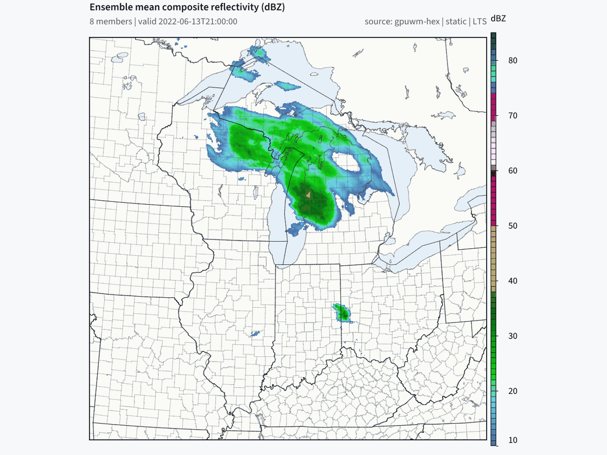

*Map.* Mean simulated radar of an eight-member ensemble, three hours in.

- **Reach it:** `gpuwm-hex ensemble-prepare` (once per cycle, public GEFS
  members) and `gpuwm-hex ensemble --manifest ... --out ...`.
- **Proven:** eight members, six hours (1,152 steps) each, one card each with
  active local time stepping; every member passed, with maps and scores.
- **Not yet:** skill against radar was weak. A 30 km hex ensemble's spread was
  64% of GEFS's at 72 hours because its members differ only in their starting
  states.
- Guide: [hourly ensemble](../hourly-ensemble.md).

## Better defaults

**Convection on variable-resolution meshes.**

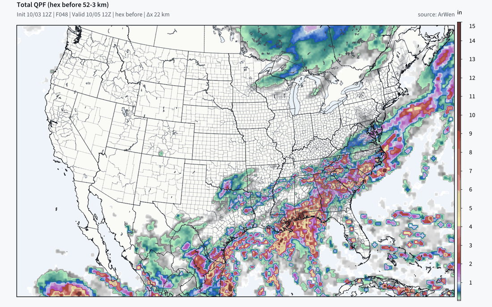
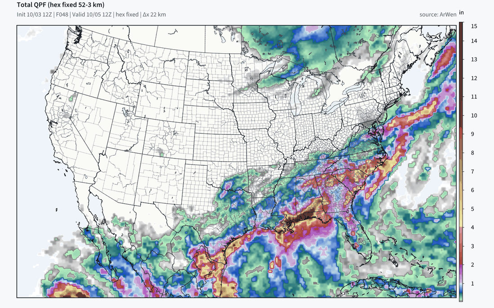

*Maps.* 48-hour rain on the 48-3 km patch mesh, before (top) and after (bottom).

The convection scheme used to be switched off on the whole mesh whenever its
finest cell was 3 km, so the 48 km cells made no convective rain at all. Now
the scale-aware scheme runs in every cell at that cell's own spacing. Against
MRMS over 48 hours: rain correlation 0.400 to 0.533, threat score at 5 mm 0.337
to 0.439, wet bias larger (1.15 to 1.49 times observed). Default on; nothing to
set.

**Noah-MP vegetation from the initial conditions.** The land model ran 90%
vegetation on every vegetated column; it now reads the mesh's own fraction
(57% on average on the measured case). Its effect on forecast scores has not
been measured yet.

**Hour-0 radar.** The first history frame's simulated radar used to be all
zeros. It is now computed from the initial rain, snow and graupel by the same
diagnostic later frames use, and the file says which (`refl10cm_provenance`).
Native MPAS and WRF write zeros at hour 0, so this is a
[declared divergence](../declared-divergences.md). Frames after hour 0 are
unchanged.

**Local time stepping, matched interface flux.**

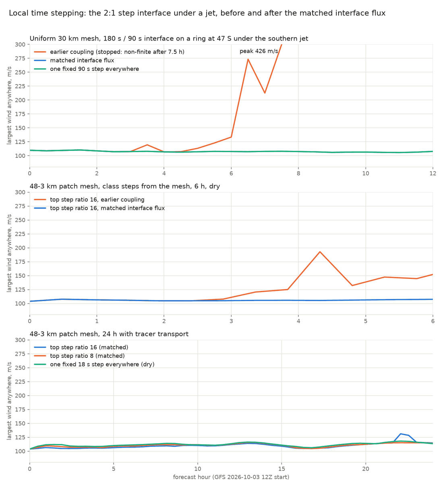

*Chart.* Largest wind in the model: the earlier coupling ran away to 426 m/s
under the jet; the matched flux follows the fixed-step run.

Where cells with a long step meet cells with a short one, the long-step side
now uses exactly the flux its finer neighbour used. Default in active local
time stepping (`--fullstep-local-timestep --fullstep-lts-mode active`); the top
step ratio stays capped at 8, because full-physics runs at 16 still stop (the
cause is not found). The fix is proven at two acoustic sub-steps (the chart).
At the default four, the port is shown stable (a 12 h 30 km jet ring peaks at
111.5 m/s, two ratio-8 islands at 109.5 m/s), but the earlier coupling also
stayed stable in that case, so the need for it at four is not shown.

**Physics fixes that reach every selection.** Kain-Fritsch accumulated
convective rain can no longer step backwards; RRTMGP no longer produces
non-finite longwave heating when a column top sits below its pressure ladder
(both in the gpuwm 2.9.0 engine); a step the physics refuses rolls back with
its refusal kept; a setting only WRF's ARW dycore reads
(such as `km_opt`) is refused by name instead of silently recorded; and each
run's receipt names the schemes it actually ran, including the Grell-Freitas
shallow switch the engine was handed.

**Two-card memory.** Same-host hashing is bounded, so the two-card Philippines
default no longer runs out of host memory.

## RRFS v2 preset (ArWen physics, RRFS-shaped)

`gpuwm preset run rrfs-v2-hex-tempo` (in gpuwm 2.9.0) now finds its runner in
the installed gpuwm-hex, so it no longer needs a source checkout. It runs
ArWen physics shaped after RRFS v2 and is labelled RRFS-shaped, not
RRFS-matched (RRFS-MPAS itself is above). With gpuwm 2.9.0, whose
`rw_mpas_init` writes the suite soil geometry (RUC's nine soil levels) and the
TEMPO aerosols, `gpuwm preset prepare rrfs-v2-hex-tempo` builds the preset's
initial state from public GFS and `gpuwm preset run rrfs-v2-hex-tempo` runs
the forecast; one 12 km 6 h one-card forecast passed and was scored against
ASOS and MRMS (the CHANGELOG has the scores). An engine that predates suite
soil geometry is refused by name at preparation.

## Not in 0.4, with the reason

- The CUDA port of Noah-MP v5.0: withheld, because UCAR's terms forbid
  selling it or any work that contains it. The native backend runs Noah-MP
  v5.0 only with `--licence-opt-in ucar-noahmp`, from a native library built
  with the same opt-in (`gpuwm-hex physics-resources build --licence-opt-in
  ucar-noahmp`); no default runs it, and the Noah-MP hex runs by default is
  the ArWen suite's WRF-lineage v4.x (WRF public-domain notice, not
  MPAS-bitwise).
- On the RRFS stage, UGWP drag (no port for the fork's driver yet), NSSL
  two-moment microphysics and smoke/dust (ported, not wired into the
  forecast) run on the native library.
- RRFS initial conditions from hex's init door: not in this release; the
  RRFS stage reads `init.nc` from the fork's own `init_atmosphere`.
- YSU and New Tiedtke single hot layers at long steps on gpuwm 2.9.0:
  ArWen-physics runs with YSU at a step above about 300 s (meshes coarser
  than about 50 km at MPAS's 6 s per km) can show the single hot layers the
  global door caps away. The cause is YSU's explicit boundary-layer-top
  entrainment and New Tiedtke's explicit rates overshooting their donor
  layers. An engine whose YSU and New Tiedtke identities are
  `ysu-wrf-v4.8.0-entrainment-courant-v2` and
  `new-tiedtke-wrf461-cumastrn-donor-bound-v2` bounds both, and
  `gpuwm-hex global` then runs the ArWen arm at the mesh's own step. gpuwm
  2.9.0, which this release requires, has neither, so on it every door's
  default step with YSU is capped at 300 s (`gpuwm-hex global` and a bare
  `gpuwm-hex forecast` alike); an explicit `--dt` runs as given.
- A full-cyclone replay of the two over-limit moves with the balance fix: not
  yet run (it needs a card with about 64 GB or more).
- An ensemble analysis inside hex global: not part of this package. Hex
  global starts from an analysis you supply (`gpuwm-hex forecast
  --analysis`); gpuwm-global keeps its LETKF.
- Graph replay for local time stepping: the class executor launches
  eagerly, so one-card LTS is slower than the fixed step. Several cards are
  an explicit opt-in (every rate class is now cut across the cards; two
  RTX PRO 6000 cards ran a 222,042-cell mesh at 15.4 s per forecast hour,
  against 26.9 on one card) and are not identical to one card.
- `gpuwm-hex render` on an RRFS run's own output: the converter stops with
  "history has no latCell", also with `--mesh`.
- IAU on multi-card local time stepping and `--balance-series` off one card:
  refused by name (the block executor has no held-tendency hook and the ranks
  no balance sampler).
- A combined correct-mode native referee: one native build carrying every
  fix is a follow-up.
- A hex-specific maths-library pin: it changes the dycore arithmetic and
  needs every native reference rebuilt.
